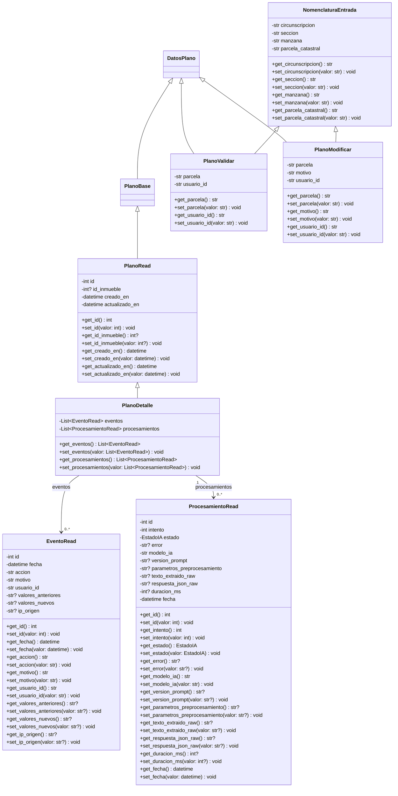
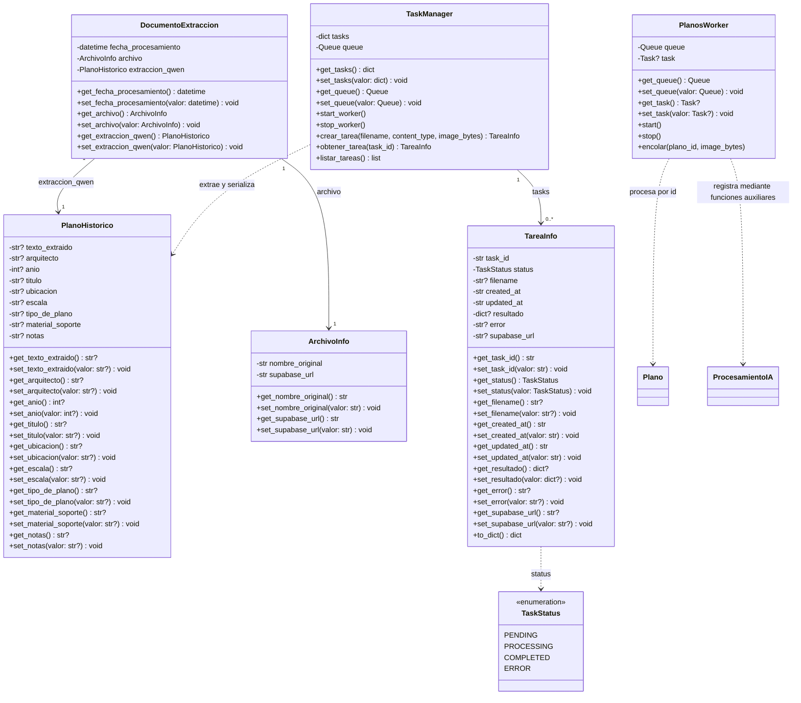

# Diagrama de clases del backend

Basado en `backend/src/models.py`, `backend/src/planos/schemas.py`,
`backend/src/tareas/schemas.py`, `backend/src/tareas/services.py` y
`backend/src/planos/worker.py`.

## Catálogo de planos

Se muestran las clases de dominio y sus atributos principales. `?` indica
un atributo opcional. Las clases SQLModel/Pydantic externas se omiten.
Los atributos heredados no se repiten en las subclases.

```mermaid
classDiagram
    direction TB
    class DatosPlano {
        -str? texto_extraido
        -str? arquitecto
        -int? anio
        -str? titulo
        -str? ubicacion
        -str? escala
        -str? tipo_de_plano
        -str? material_soporte
        -str? notas
        +get_texto_extraido() str?
        +set_texto_extraido(valor: str?) void
        +get_arquitecto() str?
        +set_arquitecto(valor: str?) void
        +get_anio() int?
        +set_anio(valor: int?) void
        +get_titulo() str?
        +set_titulo(valor: str?) void
        +get_ubicacion() str?
        +set_ubicacion(valor: str?) void
        +get_escala() str?
        +set_escala(valor: str?) void
        +get_tipo_de_plano() str?
        +set_tipo_de_plano(valor: str?) void
        +get_material_soporte() str?
        +set_material_soporte(valor: str?) void
        +get_notas() str?
        +set_notas(valor: str?) void
    }
    class PlanoBase {
        -str nombre_original
        -str content_type
        -str? hash_sha256
        -int? tamano_bytes
        -str ubicacion_fisica
        -str expediente
        -str direccion_referencia
        -str parcela
        -str circunscripcion
        -str seccion
        -str manzana
        -str parcela_catastral
        -str? nomenclatura
        -EstadoPlano estado
        -EstadoIA ia_estado
        -str? ia_error
        -str? ia_propuesta
        -str? creado_por
        -str? validado_por
        -datetime? validado_en
        -bool activo
        +get_nombre_original() str
        +set_nombre_original(valor: str) void
        +get_content_type() str
        +set_content_type(valor: str) void
        +get_hash_sha256() str?
        +set_hash_sha256(valor: str?) void
        +get_tamano_bytes() int?
        +set_tamano_bytes(valor: int?) void
        +get_ubicacion_fisica() str
        +set_ubicacion_fisica(valor: str) void
        +get_expediente() str
        +set_expediente(valor: str) void
        +get_direccion_referencia() str
        +set_direccion_referencia(valor: str) void
        +get_parcela() str
        +set_parcela(valor: str) void
        +get_circunscripcion() str
        +set_circunscripcion(valor: str) void
        +get_seccion() str
        +set_seccion(valor: str) void
        +get_manzana() str
        +set_manzana(valor: str) void
        +get_parcela_catastral() str
        +set_parcela_catastral(valor: str) void
        +get_nomenclatura() str?
        +set_nomenclatura(valor: str?) void
        +get_estado() EstadoPlano
        +set_estado(valor: EstadoPlano) void
        +get_ia_estado() EstadoIA
        +set_ia_estado(valor: EstadoIA) void
        +get_ia_error() str?
        +set_ia_error(valor: str?) void
        +get_ia_propuesta() str?
        +set_ia_propuesta(valor: str?) void
        +get_creado_por() str?
        +set_creado_por(valor: str?) void
        +get_validado_por() str?
        +set_validado_por(valor: str?) void
        +get_validado_en() datetime?
        +set_validado_en(valor: datetime?) void
        +get_activo() bool
        +set_activo(valor: bool) void
    }
    class Plano {
        -int? id
        -int? id_inmueble
        -str minio_path
        -datetime creado_en
        -datetime actualizado_en
        +get_id() int?
        +set_id(valor: int?) void
        +get_id_inmueble() int?
        +set_id_inmueble(valor: int?) void
        +get_minio_path() str
        +set_minio_path(valor: str) void
        +get_creado_en() datetime
        +set_creado_en(valor: datetime) void
        +get_actualizado_en() datetime
        +set_actualizado_en(valor: datetime) void
        +get_eventos() List~EventoAuditoria~
        +set_eventos(valor: List~EventoAuditoria~) void
        +get_procesamientos() List~ProcesamientoIA~
        +set_procesamientos(valor: List~ProcesamientoIA~) void
    }
    class EventoAuditoria {
        -int? id
        -int plano_id
        -str usuario_id
        -datetime fecha
        -str accion
        -str motivo
        -str? valores_anteriores
        -str? valores_nuevos
        -str? ip_origen
        +get_id() int?
        +set_id(valor: int?) void
        +get_plano_id() int
        +set_plano_id(valor: int) void
        +get_usuario_id() str
        +set_usuario_id(valor: str) void
        +get_fecha() datetime
        +set_fecha(valor: datetime) void
        +get_accion() str
        +set_accion(valor: str) void
        +get_motivo() str
        +set_motivo(valor: str) void
        +get_valores_anteriores() str?
        +set_valores_anteriores(valor: str?) void
        +get_valores_nuevos() str?
        +set_valores_nuevos(valor: str?) void
        +get_ip_origen() str?
        +set_ip_origen(valor: str?) void
    }
    class ProcesamientoIA {
        -int? id
        -int plano_id
        -int intento
        -EstadoIA estado
        -str? error
        -str modelo_ia
        -str? version_prompt
        -str? parametros_preprocesamiento
        -str? texto_extraido_raw
        -str? respuesta_json_raw
        -int? duracion_ms
        -datetime fecha
        +get_id() int?
        +set_id(valor: int?) void
        +get_plano_id() int
        +set_plano_id(valor: int) void
        +get_intento() int
        +set_intento(valor: int) void
        +get_estado() EstadoIA
        +set_estado(valor: EstadoIA) void
        +get_error() str?
        +set_error(valor: str?) void
        +get_modelo_ia() str
        +set_modelo_ia(valor: str) void
        +get_version_prompt() str?
        +set_version_prompt(valor: str?) void
        +get_parametros_preprocesamiento() str?
        +set_parametros_preprocesamiento(valor: str?) void
        +get_texto_extraido_raw() str?
        +set_texto_extraido_raw(valor: str?) void
        +get_respuesta_json_raw() str?
        +set_respuesta_json_raw(valor: str?) void
        +get_duracion_ms() int?
        +set_duracion_ms(valor: int?) void
        +get_fecha() datetime
        +set_fecha(valor: datetime) void
    }
    class EstadoPlano {
        <<enumeration>>
        pendiente
        validado
        sin_ubicacion
    }
    class EstadoIA {
        <<enumeration>>
        procesando
        completado
        error
        no_aplica
    }
    DatosPlano <|-- PlanoBase
    PlanoBase <|-- Plano
    Plano "1" -- "0..*" EventoAuditoria : eventos
    Plano "1" -- "0..*" ProcesamientoIA : procesamientos
    PlanoBase ..> EstadoPlano : estado
    PlanoBase ..> EstadoIA : ia_estado
    ProcesamientoIA ..> EstadoIA : estado
```

Cada evento y procesamiento pertenece a un plano por su clave foránea
obligatoria `plano_id`. Un plano puede tener cero o muchos de cada uno.
`Plano`, `EventoAuditoria` y `ProcesamientoIA` son tablas persistidas;
`DatosPlano` y `PlanoBase` aportan atributos por herencia.
Los identificadores opcionales se asignan al persistir.

## Esquemas de entrada y salida del catálogo

`EventoRead` y `ProcesamientoRead` representan la salida de la API;
son clases distintas de las entidades persistidas.

## Extracción y tareas asíncronas

`PlanoHistorico` y `DatosPlano` tienen campos similares, pero no existe
herencia entre ellos. `TareaInfo.resultado` almacena un diccionario,
no una referencia a `PlanoHistorico`. Los controladores y servicios de
planos son funciones de módulo, por eso no se inventan clases para ellos.

Este documento se centra en dominio, esquemas del catálogo y procesamiento;
omite configuración, excepciones y el esquema auxiliar de detección del cajetín.
